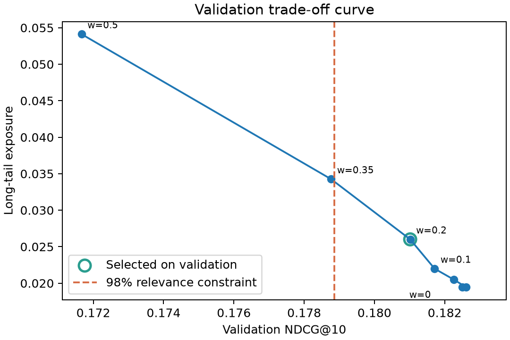

# Recommendation Lab: temporal ranking and a deployed API

A reproducible recommendation project that makes the accuracy–exposure tradeoff measurable. It includes a pinned upstream SAR/BPR reproduction, a separate chronological MovieLens 1M experiment, validation-selected novelty reranking, and a real FastAPI service running in Docker.

**Problem.** Popularity-heavy recommendations can leave much of a catalog unseen. Personalization helps relevance, but pushing less popular items can reduce ranking quality. This project quantifies that tradeoff before exposing the model through an API. It is a non-commercial research portfolio, with no claim of online revenue or click uplift.

## Measured result

The extension uses 1,000,209 historical ratings, global chronological train/validation/test splits (70/15/15 with timestamp ties kept together), and full eligible-catalog ranking. Primary test results are macro averages over **922 warm users** with eligible positive targets. Another 563 eligible cold users are reported separately. Positives are observed ratings >= 4.

| Model | NDCG@10 | Recall@10 | Long-tail exposure | Catalog coverage |
|---|---:|---:|---:|---:|
| Popularity | 0.207807 | 0.053889 | 0.0000% | 4.0650% |
| Binary Jaccard SAR-style | 0.224085 | 0.060049 | 0.1193% | 9.1173% |
| BPR | 0.244129 | 0.071576 | 1.8438% | 20.0639% |
| BPR + validation-selected novelty | 0.240935 | 0.071159 | 2.2777% | 20.9640% |

The selected weight was **0.2**, chosen on validation under a maximum 2% relative NDCG loss constraint. On held-out test it raises long-tail exposure by **0.4338 percentage points**, while NDCG falls **1.3083%** relative to BPR. The paired user-bootstrap 95% NDCG-difference interval is [-0.004972, -0.001335], so the accuracy loss should not be advertised as an accuracy gain. Two full runs with the same frozen configuration produced identical evaluation results.

See [protocol](reports/experiment/protocol.md), [full aggregate metrics](reports/experiment/summary.json), [selection before test](reports/experiment/selected_config.json), and [reproducibility check](reports/experiment/reproducibility_check.json). Long tail means the bottom 80% of the training-positive catalog by interaction count; it is not a fairness guarantee.



## What is reproduced, and what is contributed here?

- **Upstream:** [Recommenders](https://github.com/recommenders-team/recommenders), fixed commit `aa8332189cd495be6ffaa7e1c8054f1c180b5ef3`, original SAR and BPR notebook settings on MovieLens 100K. See `baseline/` and `reports/baseline/`. The original project's MIT attribution is preserved.
- **This implementation:** leakage-aware temporal protocol, data/hash checks, baseline comparison, constrained novelty selection, denominator and cold-start reporting, paired uncertainty analysis, model serialization checks, typed serving API, browser demo, readiness/metrics, Docker, and executable verification.
- **Important distinction:** the extension's binary Jaccard SAR-style implementation has no upstream time decay. Its metrics are not a numerical reproduction of the upstream SAR notebook. The two experiments use different datasets and protocols and must not be compared as a before/after gain.
- BPR and novelty reranking are established methods. This is an implementation and empirical evaluation contribution, not a claim to invent either algorithm. Development was AI-assisted; the teaching materials and exercises support independent understanding, which is not established merely by automated execution.

## Run locally (Windows PowerShell, Python 3.12)

Clone this repository, open PowerShell in its directory, and run:

```powershell
py -3.12 -m venv .venv
.\.venv\Scripts\python.exe -m pip install -r requirements-lock.txt
.\.venv\Scripts\python.exe -m pip install --no-deps -e .
.\.venv\Scripts\python.exe scripts\prepare_data.py --data-dir H:\Career_AI_Portfolio\data\movielens
.\.venv\Scripts\python.exe -m reclab.train --data-dir H:\Career_AI_Portfolio\data\movielens\ml-1m
.\.venv\Scripts\python.exe -m pytest -q
docker compose up --build -d
.\.venv\Scripts\python.exe scripts\verify_live.py
.\.venv\Scripts\python.exe scripts\benchmark_api.py --requests 500 --concurrency 8
```

Use a different data directory if needed. Read the GroupLens dataset README and [terms](https://grouplens.org/datasets/movielens/1m/) before use. Source data and derived user-history artifacts stay outside Git. The downloader pins SHA-256 and detects modified extracted files. Training creates `artifacts/model.joblib` and aggregate reports; it is required before `docker compose up`.

Open **http://127.0.0.1:8011**. Enter user **1161** for a trained user, or leave it blank for cold-start popularity. User 1 is a cold user in this time split. Choose a genre to restrict candidates. Manual reranking weights are exploration settings; the recorded evaluation only supports the frozen selected configuration.

API explorer: **http://127.0.0.1:8011/docs**. Expand `POST /recommendations` → `Try it out` → edit JSON → `Execute`:

```json
{"user_id":1161,"k":10,"preferred_genres":[],"novelty_weight":null}
```

The response contains version, effective strategy/weight, latency, movie IDs, metadata and scores. Scores are relative ranking values, not probabilities. Unknown IDs receive a defined fallback. Invalid size/genre inputs return HTTP 422. A missing or malformed trusted artifact leaves `/health` alive and `/ready` at HTTP 503.

## Deployment and evidence

The Docker image pins its Python base by digest, runs as UID 10001, binds only to loopback, and mounts the local model read-only. Training dependencies are excluded from the serving environment. Deployment is **verified on local Docker Desktop**, not a public cloud endpoint. See [operations guide](docs/operations.md) and `reports/operations/` for real HTTP checks, latency measurement and failure/recovery evidence. Single-process rolling counters are demonstration monitoring, not a distributed observability platform or production SLO.

```text
official data → integrity audit → chronological split → train-only baselines
       → validation weight selection → frozen test evaluation → versioned artifact
       → FastAPI + Docker → browser + HTTP checks + bounded load test
```

`src/reclab/` contains the implementation; `configs/` freezes experiment choices; `tests/` covers leakage boundaries, ranking math, ID alignment, fallback and API failure behavior; `teaching/` contains Chinese-first source lessons and a searchable line-by-line code companion. Local DOCX/PDF/screenshots are delivered separately. See [career narrative](docs/career_story.md).

## Limits and next experiment

MovieLens 1M is historical explicit-rating data, not modern exposure logs. Missing ratings are not proven dislike. The candidate catalog excludes items without training positives. Warm target eligibility and exclusions are reported; warm metrics alone do not describe all users. The frozen service filters training history at the first cutoff, while the test evaluator additionally filters validation-period history. They therefore represent different observation times, documented in the artifact protocol.

One temporal split and one training seed were used. User bootstrap does not cover training randomness or temporal drift. No online experiment, causal uplift, production traffic, authenticated user feedback, or cloud scaling is claimed. A next experiment should preregister several rolling time windows and seeds, then examine whether the exposure tradeoff persists before any online trial.

Original code is MIT licensed. Dataset use is governed separately by GroupLens terms. See [third-party notices](THIRD_PARTY_NOTICES.md).
