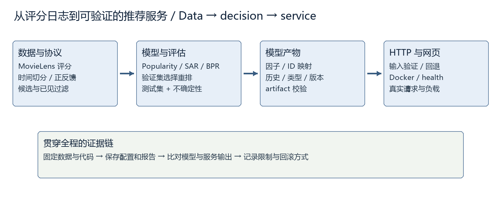
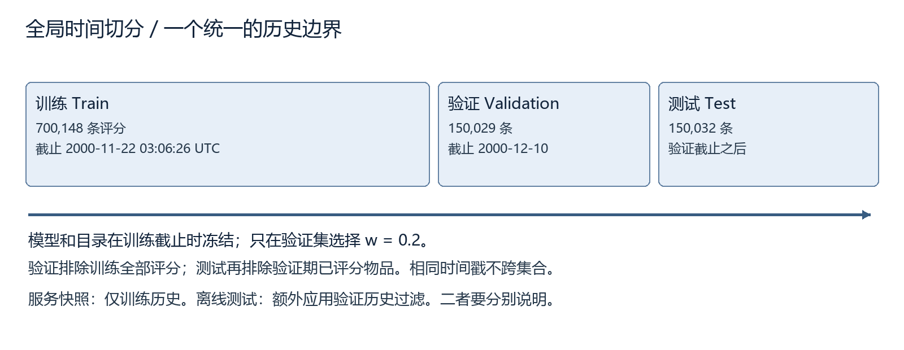
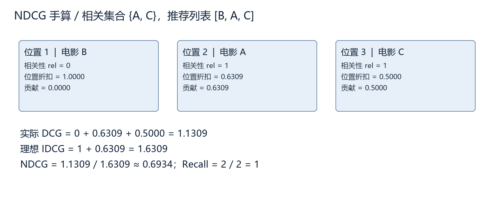
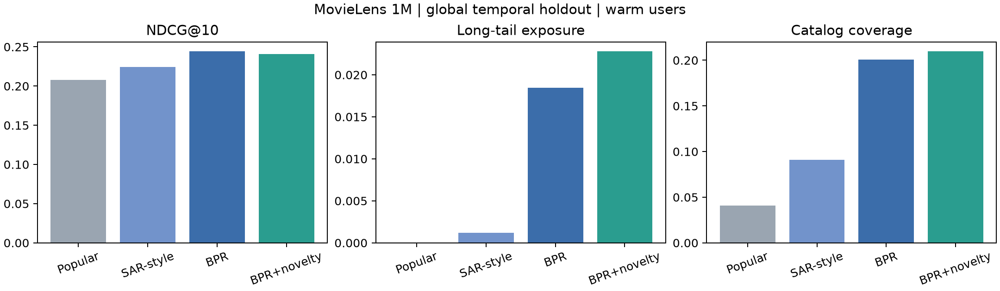

# 个性化推荐与排序服务完整学习手册

这份手册带你从公开评分数据出发，走完“定义推荐任务、复现已有方法、设计公平实验、解释数学、扩展排序、封装接口、检查部署、展示证据”的完整过程。学习目标是能独立说明每个模块为什么存在，能重跑项目，能发现评测或服务中的错误，并能把自己的贡献讲清楚。

本项目选择电影推荐作为可控的学习场景。它使用历史评分，不拥有真实电商购买、曝光或收入记录。因此，模型得分和离线排序指标用于比较实验条件下的表现；它们不能直接解释为用户购买概率或真实营收增长。

The goal is to build, evaluate and serve a reproducible recommendation system, then explain the trade-offs with traceable evidence.

本书与《代码逐行阅读指南》配套使用。主手册顺着学习逻辑解释原理、操作与结果；伴册按实际文件和行号定位代码。相同安装步骤只讲一次，后文引用对应步骤；重要公式和决策不会因为压缩篇幅而省略。

## 1 从问题到可验收的系统

### 1.1 推荐任务到底预测什么

分类通常要求判断一个给定样本的类别；评分预测要求估计一个用户会给某个物品打几分；排序推荐则要求从候选集合中排出最值得展示的若干项。三者可以共享模型，但训练目标和评测方法不同。

本项目的接口返回前 K 个推荐，也称 Top-K recommendation。对于用户 u，先确定当前可推荐的候选物品集合，再为每个候选计算分数，排除已经见过的物品，最后按确定的规则取前 K 项。这里的“见过”必须由协议定义：本项目的实验会记录哪些历史评分被视为已见，不把未来评分提前放入历史。

$$L_u=\operatorname{TopK}_{i\in C_u}\,s(u,i)$$

u 表示用户，i 表示物品，C_u 是该用户的候选集合，s 是模型分数，L_u 是有顺序的推荐列表。TopK 只规定取分数最大的 K 项；分数相同如何处理、可用候选不足 K 项怎么办，还需要由实现明确。

比如用户已经评价过 A 和 B，候选是 C、D、E。模型分数依次为 0.3、0.8、0.8。当 K=2 时，D 与 E 都会入选；如果只取一项，就需要稳定的并列规则。固定按物品 ID 排序，可以避免同一模型在不同运行中因为不稳定排序产生不同列表。

### 1.2 三个痛点分别怎样验证

第一个痛点是相关性：推荐列表中是否能找到用户后来给出正面评价的电影。第二个是覆盖：模型会不会反复推荐少数热门电影，使其他内容很少获得推荐。第三个是可用性：新用户、未知用户或服务重启时，系统能否给出明确而可解释的结果。

这些问题不能用一个平均分回答。相关性主要看 NDCG、Recall；覆盖看不同物品被推荐的比例及长尾曝光；服务可用性看输入校验、冷启动回退、接口响应、版本和故障测试。把几个维度一起报告，才能判断一项改动到底带来了什么。

“更复杂”不是验收标准。增加重排步骤以后，如果覆盖上升而相关性下降，我们需要说明下降多少、是否仍在预定预算之内。若简单的流行度方法已达到相同效果，就没有理由因为模型名字更长而默认保留复杂模型。

### 1.3 两条实验轨道不能混用

上游复现轨回答“在尽量相同的条件下，公开示例能否重跑”。自有时间实验轨回答“在只允许使用过去信息的条件下，几种方法和扩展如何比较”。两条轨道解决的问题不同，必须分别保存配置与结果。

官方 SAR 与 BPR 示例的切分、正反馈定义和候选处理并不完全一样。我们可以分别复现它们，但不能拿两份不同协议的分数直接得出算法优劣。公平比较时，先统一协议，再比较模型。

| 记录项 | 上游复现轨 | 自有实验轨 |
| --- | --- | --- |
| 核心目标 | 核对公开示例行为与结果 | 检验自己的改进假设 |
| 切分 | 保留原示例规定 | 预先规定时间窗口 |
| 调参 | 保留原设置并记录兼容修改 | 仅使用训练与验证信息 |
| 测试结果用途 | 说明复现差距 | 一次检验固定选择 |
| 必须保留 | 原作版本与修改差异 | 实验协议与负结果 |

### 1.4 项目的输入输出关系



图中每条箭头都代表一次数据或状态交接。原始文件经过校验和解析后形成评分表；切分器决定哪个时点可以看见哪些记录；训练器生成模型；评测器比较推荐与后续正反馈；服务层加载已经保存的模型，再向界面或客户端返回结果。图为教学重绘，不是某次运行截图。

模型训练和API推理是不同阶段。训练更新参数，通常耗时较久；服务启动时加载模型，处理请求时只做过滤和排序。本项目将两者分开，避免每次HTTP请求重复训练造成延迟和版本混乱。

## 2 理解数据后再写模型

### 2.1 评分记录的含义

MovieLens 的基本观察单位是一条用户对电影的评分。userId、movieId 是标识符，不是连续大小有意义的数值特征；rating 是显式评分；timestamp 是事件发生的 Unix 时间。电影表补充标题和类型等元数据。100K 与 1M 的文件格式不同，因此解析代码要明确对应哪个版本，不能只改文件名后假设字段相同。

一条 5 分记录可以支持“这个用户给这部电影较高评价”。没有记录则只代表没有观察到评分：用户可能没看过、没接触过、不想评分，或者数据收集没有覆盖。它不等同于明确讨厌这部电影。

这一区别影响BPR负采样。当前模型从“未作为训练正例出现的物品”中采样，可能包含已有低评分记录。训练假设是观察到的正反馈通常应排在这些比较项前面；它没有把未评分电影认定为真实负类。

### 2.2 正反馈阈值与已见历史

为了做 Top-K 排序，我们把评分达到阈值的记录当作正反馈。阈值本身是一项建模选择，应在比较模型前规定。改阈值会改变正例数、用户活跃度、物品流行度和指标分母。

$$y_{ui}=\mathbb{1}[r_{ui}\geq 4]$$

r 是原始评分，y 是二值正反馈，指示函数在条件成立时为 1，否则为 0。这里的 0 包含低评分记录，但没有评分的用户物品对仍然是未观察项。不能在解释中把这两种 0 混成同一种信息。

用于训练偏好的记录和用于过滤已见物品的记录也可能不同。一个用户给电影打了 2 分，它不是正反馈，但系统通常不应再次把这部电影当作全新推荐。因此，代码需要分别维护“正反馈矩阵”和“已见历史”，并在评测协议里说明具体口径。

### 2.3 文件校验与数据来源

下载成功首先表示拿到了文件；它不自动表示文件完整、版本正确或可以再分发。项目记录来源 URL、文件大小、SHA-256 和数据说明，下载脚本在读取前检查预期文件及必需字段。

SHA-256 把文件内容映射为固定长度摘要。相同摘要可用于核对两份文件是否具有相同字节内容；它不证明来源可信，也不能检查评分是否真实。因此，来源、许可、摘要和内容检查承担不同职责。

原始 MovieLens 数据保存在项目外的数据目录，不进入公开代码仓库。公共仓库应保留下载和解析脚本、数据版本、摘要与可复算的指标。发布训练产物或演示内容时还要考虑它是否包含可恢复的原始评分或受限制的再分发内容。

### 2.4 四项最早做的检查

检查字段类型：标识符应可稳定映射，评分应在数据集允许范围内，时间戳应能解释。检查缺失与重复：重复用户物品记录可能影响计数和切分；不能无理由把所有缺失填 0。检查计数：原始条数、用户数、物品数与解析后是否一致。检查时间范围：时间戳最小值、最大值与切点是否合理。

这些检查要在训练之前执行，因为后面的高分无法补救错误输入。例如，若把电影 ID 当作行号，遗漏的 ID 会造成向量错位；模型仍可能返回数字，但推荐电影已不是原来的那一项。

## 3 环境与目录怎样连接起来

### 3.1 理解解释器与虚拟环境

Python 解释器负责运行程序，第三方包提供数据、模型和服务能力。虚拟环境为一个项目保留自己的解释器入口与包版本。它能减少不同作业之间的依赖冲突，但不会自动冻结依赖，也不会隔离 GPU 驱动、操作系统或网络。

本项目的开发环境与上游复现环境分开：核心服务使用项目根目录的 .venv；复现脚本可以使用 baseline/.venv。这样，旧示例依赖不会迫使整个服务使用相同的版本。运行任何命令前，先检查当前目录和实际 Python 路径。

在 PowerShell 中，前缀 .\ 表示当前目录中的文件。直接写 python 时，系统按 PATH 查找解释器；写 .\.venv\Scripts\python.exe 时，明确选择本项目环境。教学中的命令采用明确路径，减少“包已经装了但 import 失败”的混淆。

### 3.2 一张目录图说明职责

| 目录 | 保存什么 | 为什么分开 |
| --- | --- | --- |
| src/reclab | 数据、模型、指标、重排及服务代码 | 让各模块可以独立测试 |
| baseline | 上游复现脚本与环境说明 | 原样复现与自己的实验分开 |
| configs | 数据和实验设置 | 把协议与代码逻辑分开 |
| reports | 真实结果、运行记录和质量检查 | 让简历数字能回链到证据 |
| artifacts | 本地生成的模型产物 | 服务加载，无需每次请求训练 |
| tests | 针对错误边界的测试 | 防止修一个地方破坏另一个 |
| teaching | 手册、源稿、截图与逐行说明 | 学习材料随代码一起维护 |

数据、模型缓存和外部代码要有清楚的来源，不与自己的源码混在一起。文件夹名不是证据；最终还要看清单中的版本和实际内容。代码中应使用可配置路径，避免把本机 H 盘路径写成所有机器都必须拥有的条件。

### 3.3 从命令认识一条执行链

一个训练命令通常由解释器、模块入口和参数组成。解释器决定用哪个环境；-m 让 Python 按模块名寻找入口；数据路径告诉程序读取哪一份资料；配置路径规定协议；输出路径指定本次结果保存在哪里。

日志中的“开始训练”“保存成功”和“进程退出码 0”各自只说明一个步骤。完整检查还要读结果文件，确认行数、指标、版本和模型大小合理，并实际加载一次产物。后文的操作章列出本项目最终核验过的命令和输出。

### 3.4 出错时按层定位

ModuleNotFoundError 先检查解释器和包环境；FileNotFoundError 先检查工作目录及绝对路径；解析列数不对先检查数据版本和分隔符；内存不足先看矩阵形状和稀疏表示；HTTP 422 先看请求字段；HTTP 503 则检查服务是否已加载模型。

不要一遇到异常就重新安装所有软件。保留完整错误栈，定位最早由本项目引起的错误位置，再做最小修改。改完重新运行相关检查，并把原因和修复记录在变更日志中。

## 4 时间切分与信息边界

### 4.1 为什么随机切分可能乐观

随机切分把同一段历史中的记录打散。训练集中可能出现一个用户较晚的偏好，而测试集包含该用户更早的评分。这对“随机缺失评分补全”可以是合法协议，但如果目标是模拟将来上线，它就允许模型使用在预测时尚不存在的信息。

时间切分按事件时间安排训练、验证和测试。设两个切点 t1、t2：训练只看 t1 之前，验证看中间窗口，测试看 t2 之后。最关键的不是使用某个函数，而是对每项特征、候选资格和参数选择都执行相同的信息边界。

$$D_{train}=\{(u,i,r,t):t\leq t_1\}$$

$$D_{valid}=\{(u,i,r,t):t_1<t\leq t_2\},\qquad D_{test}=\{(u,i,r,t):t>t_2\}$$

不等号的边界必须与代码一致。若多个事件具有同一时间戳，不能因为数组位置而把一部分当作过去、一部分当作未来，却仍宣称使用严格时间边界。本项目记录实际切点与每个分区的范围。



图中训练、验证、测试沿时间排列。上方实线是可用过去，下方回流箭头表示禁止把未来统计量带回训练。图为教学示意；本次实际切点和样本数量在结果章中列出。

### 4.2 全局切分与逐用户切分

逐用户保留最后若干次评分，可以让更多用户同时拥有训练和测试记录；但不同用户的测试时间可能互相交叠。于是一个用户测试时点以后的其他用户记录，仍可能进入模型训练。

全局时间切分让所有用户共享时间边界，更接近某个统一上线时点。不过，一些用户只在测试期出现，这些用户就成为冷启动；一些电影也在后期才出现。这些困难是该协议揭示的真实限制，不应为了让所有用户可预测而偷偷删掉后再只报告最好看的分数。

### 4.3 候选资格也是一种信息

假设电影 X 直到测试期才第一次出现在记录中。若训练期的候选集合已经包含 X，并使用测试期计算的流行度或类型统计，模型就得到了未来信息。项目必须规定候选集合如何产生，并记录无法评估的用户或物品占多少。

电影类型等静态元数据也要解释来源时间。对于历史离线基准，我们可以把随数据发布的元数据用于教学实验，但不能因此声称它精确模拟了当年的线上数据可得性。只要信息边界的限制如实记录，实验仍然有可比较价值。

### 4.4 验证集与测试集各做什么

训练集用于拟合参数。验证集用于选择超参数、重排权重或模型。测试集用于对已经固定的选择做最后评估。若看了测试结果再调整权重，测试集就逐渐变成另一个验证集，最终报告会产生选择偏差。

本项目先写实验协议，再运行锁定测试。如果扩展没有达到约束，保留原模型和负结果；不能一边看测试分数一边增加候选权重，直到出现改善。后续确需改变设计时，应新建实验版本并重新定义独立评估，而不是覆盖旧结果。

## 5 先理解流行度基线

### 5.1 简单基线为什么必要

流行度推荐按训练期正反馈次数排序。它不使用用户个性偏好，却常常是一个强而廉价的参照：热门电影得到较多评分，也可能在测试中更容易出现。没有这个基线，就难判断复杂模型到底增加了什么。

$$c_i=\sum_u y_{ui},\qquad s_{pop}(u,i)=c_i$$

c_i 是电影 i 的训练期正反馈计数。虽然分数不依赖用户，最终列表仍会排除该用户已经见过的电影，因此不同用户可能得到不同列表。新用户没有可用历史时，流行度也能提供明确的回退方案。

### 5.2 流行度的偏差怎样表现

高计数既可能来自较多人喜欢，也可能来自较多曝光、较长上映时间或特定群体更愿意评分。评分数据没有随机曝光记录，因此我们不能把计数直接解释为物品的内在质量。

流行度基线往往有较高命中机会，却可能只有较低的目录覆盖率。引入长尾目标前，先量化这一现象：多少不同电影真正出现在推荐列表里，热门组与长尾组各占多少位置。否则“推荐更丰富”只是一句印象描述。

### 5.3 一个小例子

训练正反馈计数为 A=100、B=60、C=10、D=2。用户已经看过 A，K=2，流行度列表是 B、C。若另一用户没有历史，列表是 A、B。这说明个性化过滤和个性化评分是两回事：过滤不同，不代表模型学到了个性偏好。

实现时先排序再过滤与先过滤再取 K，在候选足够时可以等价；如果代码先截取很短的全局候选，再过滤已见物品，可能返回不足 K 项。测试需要覆盖这种情况。

## 6 SAR 从共现关系得到推荐

### 6.1 两个矩阵承担不同职责

SAR 是基于物品相似度的推荐方法。第一部分描述用户与物品的亲和程度，第二部分描述物品与物品之间的关系，最后把二者相乘得到候选分数。官方实现可以使用评分权重与时间衰减；自有实验的具体亲和矩阵以实际配置为准，不能混为同一个实现。

设有 m 个用户、n 个电影。A 的形状是 m×n，A_ui 表示用户 u 对物品 i 的亲和度。S 的形状是 n×n，S_ij 表示物品 i 与 j 的相似度。推荐分数矩阵 P=A S，形状仍为 m×n。

$$P=A S,\qquad p_{uj}=\sum_i A_{ui}S_{ij}$$

这个求和有直接意义：用户喜欢过的每部电影，都按照其亲和权重，为相似电影投出一部分分数。它并不需要学习神经网络参数，但仍然需要正确构造矩阵和防止信息泄漏。

### 6.2 Jaccard 相似度的来源

令 N_i 为训练中对电影 i 有正反馈的用户集合。Jaccard 相似度用交集人数除以并集人数。两部电影的共同受众越多、各自独有受众越少，相似度越高。

$$S_{ij}=\frac{|N_i\cap N_j|}{|N_i\cup N_j|}$$

例如 N_A={1,2,3}，N_B={2,3,4,5}。交集大小为2，并集大小为5，相似度是0.4。这个值反映共同评分模式，不是内容语义相似度，也不是“推荐 B 的成功概率为40%”。

若用二值交互矩阵 X，X 的形状为 m×n，则 X 的转置乘 X 得到 n×n 的共现计数矩阵。对角元素是各电影的用户计数；非对角元素是共同正反馈人数。

$$C=X^T X,\qquad S_{ij}=\frac{C_{ij}}{C_{ii}+C_{jj}-C_{ij}}$$

分母可能为0时必须有定义，例如把该相似度设为0。自相似是否清零、低频阈值如何设置、是否使用收缩，都需要与具体实现一致，不能只凭公式猜测。

### 6.3 时间衰减为什么改变亲和度

有些 SAR 配置认为近期行为更能代表当前兴趣，因此让较旧的事件权重下降。半衰期 h 表示经过 h 个时间单位后权重减半；时间差和 h 必须使用同一单位。

$$w(t)=2^{-\Delta t/h}$$

当 Δt=0 时权重为1；Δt=h 时为0.5；Δt=2h 时为0.25。若时间戳以秒保存，而 h 被当作天直接代入，结果就会极端衰减。实现中把天换成秒或者把时间差换成天，两种方法只能一致地选择一种。

时间衰减是一种偏好建模假设，不一定对每个用户都更好。上游复现保留原设置，自有公平实验记录实际是否启用；不能在无衰减结果上解释“近期偏好被加强”。

### 6.4 稀疏矩阵与内存

用户通常只评价了少量电影，用户物品矩阵大多数位置为0。CSR 稀疏格式主要存非零值、列索引和行边界，适合按用户取行。它减少了存储交互矩阵的成本，但物品相似度矩阵可能变密，因此仍要检查 n×n 的规模。

float32 每个元素通常占4字节。n=4000 时，一个完整的 n×n 数组约为64MB，尚未计中间数组和Python对象。若 n 扩大十倍，矩阵元素增加一百倍。这个平方关系解释了为什么小基准可用的方法，不应直接宣称能处理任意互联网级目录。

## 7 BPR 学的是相对顺序

### 7.1 从矩阵分解开始

矩阵分解为每个用户学习一个 d 维向量 p_u，为每个物品学习一个 d 维向量 q_i。点积把二者的交互压缩成一个分数。某些实现还包含物品偏置 b_i，具体以训练库配置为准。

$$s(u,i)=p_u^T q_i+b_i$$

p_u 和 q_i 都属于 d 维实向量，点积结果是标量。潜在维度不是预先命名的“喜剧程度”“动作程度”；训练得到的坐标通常不能直接作这种语义解释。维度越大，表达能力可能越强，同时也增加参数、计算和过拟合风险。

### 7.2 训练样本是三元组

BPR 使用三元组 (u,i,j)：u 是用户，i 是观察到的正反馈物品，j 从该用户训练正反馈集合之外抽样。本实现只把rating≥4输入Cornac，因此低评分电影也可能被采成j；“未观察”在这里准确说是未观察到正反馈，不等于用户从未评分。目标是让i分数高于j。令Δ=s(u,i)−s(u,j)，把Δ送入sigmoid得到偏好模型值。

$$\sigma(x)=\frac{1}{1+e^{-x}},\qquad \Delta_{uij}=s(u,i)-s(u,j)$$

若 Δ=0，模型值为0.5；Δ越大越接近1。这个sigmoid在训练目标中表示相对顺序的偏好建模，不自动成为经过校准的真实用户选择概率。尤其是负样本来自我们规定的采样分布，概率解释还依赖额外假设。

### 7.3 为什么取负对数

我们希望正反馈物品排在未观察项前面，因此希望 log σ(Δ) 越大越好。多数优化器最小化损失，于是取负号。再加入L2正则，限制参数过度增大。

$$L_{uij}=-\log\sigma(\Delta_{uij})+\frac{\lambda}{2}(\|p_u\|^2+\|q_i\|^2+\|q_j\|^2+b_i^2+b_j^2)$$

这是一次三元组更新的教学损失，λ≥0控制正则强度；用λ/2使梯度中的系数为λ。若把所有三元组损失相加，同一参数的正则会随抽样次数重复出现，不能直接当成全体参数只正则一次的全局目标。Cornac按采样更新；不同库的reg数值不必有相同效果。

教学例子：Δ=1 时 σ(1)约0.7311，损失约0.3133；Δ=−1 时损失约1.3133。正确顺序且有一定间隔时，损失较小；反向排序受到更大惩罚。后文的数值核验会重新计算这些值。

### 7.4 把梯度符号推清楚

先用链式法则：sigmoid的导数为σ(x)(1−σ(x))；log的导数为1/输入。因此 d log σ(x)/dx=1−σ(x)=σ(−x)。负对数损失的导数则带负号。

$$\frac{d\ell}{d\Delta}=\sigma(\Delta)-1=-\sigma(-\Delta)$$

若忽略偏置，Δ=p_u^T(q_i−q_j)，所以对p_u的导数是q_i−q_j，对q_i的导数是p_u，对q_j的导数是−p_u。把链式法则和正则项相加，就得到下面的梯度。

$$\nabla_{p_u}L_{uij}=-\sigma(-\Delta)(q_i-q_j)+\lambda p_u$$

$$\nabla_{q_i}L_{uij}=-\sigma(-\Delta)p_u+\lambda q_i$$

$$\nabla_{q_j}L_{uij}=\sigma(-\Delta)p_u+\lambda q_j$$

偏置也需要更新：对b_i的梯度为−σ(−Δ)+λb_i，对b_j为σ(−Δ)+λb_j。导出模型时因此同时保存item_biases，不能只保存两个因子矩阵。

梯度下降用参数减去学习率乘梯度，因此正则项会使参数朝0收缩。若写最大化log概率，则应使用梯度上升，并同时改变正则项符号。把最大化公式与最小化更新规则拼在一起，是常见符号错误。

### 7.5 用有限差分检查推导

有限差分直接比较函数在参数附近的变化。对标量x，中心差分用x+h与x−h的函数值估计导数。它是一种数值检查，不是对所有输入的形式证明；h过大有截断误差，过小又可能有浮点消减误差。

$$f'(x)\approx\frac{f(x+h)-f(x-h)}{2h}$$

在x=1、h=10^{-6}时，log σ(x)的差分约为0.268941，负log σ(x)约为−0.268941。这个符号与上面的推导一致。检查向量梯度时，每次只改变一个坐标，并比较解析梯度和数值梯度的相对误差。

### 7.6 负采样影响学到什么

均匀采样让每个未观察物品获得相同采样机会；按流行度采样则更多抽到热门物品。两者构造的训练难度和目标分布不同，不能在没有说明的情况下视为同一实验。

本实现采样时排除已知正反馈，但低评分仍可能成为比较项j。服务和评估则排除全部已评分电影，这是另一条规则：训练要学习相对偏好，推理要避免重复推荐。不能把两者混为同一种seen过滤。把已知正反馈误当负样本会制造矛盾的偏好对。

随机种子帮助重放随机过程，但多线程执行顺序、库版本和数值实现仍可能改变结果。为便于复现，可以固定单线程BPR；这不代表生产环境必须单线程，而是把实验随机性尽量控制住。

## 8 怎样计算和解释 Top K 指标

### 8.1 先确定每位用户的相关集合

对用户u，令R_u是测试期可评估的正反馈物品集合，L_u是长度不超过K的推荐列表。相关性采用二值定义：推荐电影是否在R_u中。测试中没有正反馈的用户，其Recall分母为0，需要单独记录，而不是不加说明地把结果当0或直接抹去。

$$\operatorname{Recall@K}(u)=\frac{|L_u\cap R_u|}{|R_u|}$$

Recall衡量找回了多少测试正反馈，不关心它们在列表中的具体位置。一个用户测试期有2个正反馈，另一个有20个，命中2个时两人的Recall分别是1和0.1。因此，平均前需要明确按用户平均还是把所有命中与正例合并。

### 8.2 NDCG 为什么考虑位置

DCG给靠前的相关物品更大权重，二值相关性下常用对数折扣。IDCG是在同样K和相关物品数下的理想DCG。两者相除后，NDCG通常位于0到1之间。

$$\operatorname{DCG@K}(u)=\sum_{r=1}^{K}\frac{\operatorname{rel}_{u,r}}{\log_2(r+1)}$$

$$\operatorname{NDCG@K}(u)=\frac{\operatorname{DCG@K}(u)}{\operatorname{IDCG@K}(u)}$$

r是从1开始的名次，不是评分。rel为0或1。理想排序把可用正例放到最前面，最多放min(K,|R_u|)个。若IDCG为0，应该遵循预先规定的不可评估处理规则。

### 8.3 一道完整手算

设K=3，测试正反馈为{A,C}，推荐列表为[B,A,C]。命中2个，Recall@3=2/2=1。名次1不相关，名次2与3相关，所以DCG=1/log2(3)+1/log2(4)≈1.130930。

理想列表把两个正反馈放前两名，所以IDCG=1+1/log2(3)≈1.630930。NDCG约为0.693426。虽然Recall已经为1，排序仍有改进空间；把A、C移到前两名后，NDCG会成为1。



图把命中与位置分开显示：两个列表都找回了A和C，但第一个位置是否放相关项，会改变折扣后的总分。这是教学小样本，不是项目实验结果。

### 8.4 覆盖率与长尾曝光

目录覆盖率统计所有推荐列表一共出现过多少不同物品，再除以可推荐目录大小。它描述曝光分散程度，不能证明每个曝光都对用户有用。

$$\operatorname{Coverage@K}=\frac{|\bigcup_u L_u|}{|C|}$$

长尾集合T可以根据训练期流行度阈值定义。定义方法必须在测试之前固定，例如按训练计数划分热门组与剩余组。长尾曝光率统计推荐位置中属于T的比例。

$$\operatorname{TailShare@K}=\frac{1}{N}\sum_u\frac{\sum_{i\in L_u}\mathbb{1}[i\in T]}{|L_u|}$$

代码先计算每位用户列表的长尾比例，再对用户取平均（macro）；上式N是参与计算的用户数。本次922人都返回10项，因此它恰好等于“长尾位置总数/全部9,220个位置”的micro比例。若列表长度不同，两者不等价，不能直接用用户数乘K作为实际位置分母。覆盖率、长尾比例与个体列表多样性也不是同一指标。

### 8.5 指标常见陷阱

候选集合变小会让命中更容易；抽样负候选与完整目录评估不应混比。把训练已见物品保留在推荐里可能产生看似好看的分数，却违背“推荐新内容”的任务。不同正反馈阈值会改变相关集合。只报告可预测用户而不报告被排除的比例，会掩盖冷启动问题。

因此，指标后面必须跟着协议：数据、切分、用户范围、候选集合、K、正反馈阈值、过滤历史的方法和聚合方式。没有这些条件，一个NDCG数值几乎无法用于公平比较。

## 9 在相关性预算内增加覆盖

### 9.1 从模型分数到重排分数

原模型分数通常首先服务于相关性目标。重排在较小候选池上重新选择顺序，加入新颖性或多样性。它比重训整个模型更容易独立比较，也容易通过权重控制影响大小。

当前实现把训练期流行度先做log1p压缩，再除以目录中最大值并取补数。最热门物品的新颖性为0；计数越小，新颖性越高。这是可控的排序特征，并不是从真实曝光数据估出的偏好概率。

$$v_i=1-\frac{\log(1+c_i)}{\max_j\log(1+c_j)}$$

c_i是训练正反馈计数，分母只用训练目录。全体计数为0时，函数返回全1以避免除0。v_i不是物品质量，也不保证用户喜欢。加入它的目的，是在相关候选之间给较少见的内容一个可控的机会。评估表中的平均负对数新颖性是另一项统计量，不要与此排序特征混淆。

### 9.2 为什么要归一化

原模型分数可能是负数或较大实数，新颖性则可能落在另一个范围。直接相加时，同样一个权重可能产生完全不同的影响。因此，先说明每个分量的尺度，再决定组合。

本实现是在候选池内做min-max归一化；分数全相等时确定设为全0，避免除以0。归一化改变的是量纲，不会把分数校准成概率。必须检查高低排序是否仍与原模型一致。

$$\widetilde{s}_i=\frac{s_i-s_{min}}{s_{max}-s_{min}}$$

当分母为0时使用代码明确的边界处理。候选池大小也影响min和max，因此它是算法配置的一部分，不是可忽略的实现细节。

### 9.3 相关性与新颖性的权重

当前实际执行的重排只有两个分量：候选池内的相关性与上述新颖性。候选池固定为原BPR排名前100个尚未评分的物品；重排不能召回池外的电影。

$$r_{ui}=(1-w)\widetilde{s}_{ui}+wv_i,\qquad 0\leq w\leq 1$$

w是新颖性权重。w=0时，代码直接保留原始BPR顺序，避免归一化带来的浮点并列改变。w>0时按混合分数降序，完全相同则按原始item_id升序。这里没有实现类型多样性惩罚，也没有宣称使用全局最优的组合优化。

一种未来扩展是每加入一部电影，就惩罚候选与已选电影的类型相似度。这会变成依赖当前列表的贪心重排，必须另外做消融；本次结果不能当作这个扩展已经完成的证据。

### 9.4 用验证约束选权重

我们不预先宣称某个权重最好。先在验证集比较有限的候选权重，再要求NDCG不能相对基线损失超过预定比例δ。在满足条件的权重中，再依据预先规定的覆盖或长尾目标选择。

$$\operatorname{NDCG}_{rerank}\geq(1-\delta)\operatorname{NDCG}_{base}$$

δ是可以接受的相关性损失预算，不是统计显著性水平。若基线NDCG=0.20，δ=0.02，则下限为0.196。若所有非零权重都低于下限，选择不重排是合法结果。测试集只用来检验已选方案，不再重新挑权重。

### 9.5 消融怎样定位贡献

完整方案可能同时改变候选池、新颖性、类型惩罚和冷启动策略。如果只比较“旧版”和“新版”，无法知道改善来自哪里。消融实验每次去掉一个组件，其他条件尽量保持一致。

本项目实际保留原BPR排序、验证权重网格、最终w=0.2重排。w=0就是移除新颖性分量的对照。由于没有实现多样性惩罚，结果中也没有虚构“无多样性”消融。候选池固定100，当前结果不回答其他池大小是否更好。

## 10 不确定性与失败分析

### 10.1 为什么平均值还不够

两个模型的平均NDCG差异可能很小，而且用户之间差异很大。一次平均数不能告诉我们差异是否稳定，也不能说明哪类用户受益。我们保留逐用户指标，用相同用户作成对比较。

$$d_u=m_u^{new}-m_u^{base},\qquad \overline{d}=\frac{1}{N}\sum_{u=1}^{N}d_u$$

m可以是NDCG或Recall。成对差异利用同一用户的难度作参照，比把两个独立均值的误差简单相加更贴合实验设计。用户数量N是可评估用户数，不是评分行数。

### 10.2 用户级 bootstrap

用户级bootstrap每次有放回地抽取N个用户，并计算这组用户的平均差异。重复B次后，用经验分位数形成区间。抽样单位选用户，是因为同一用户的多个推荐位置并不独立。

如果95%区间跨过0，数据仍允许正差异和负差异；不能写“已证明提升”。如果不跨0，也不代表对所有未来用户都提升，因为区间只反映当前评测样本和抽样假设下的不确定性。

bootstrap重复次数、随机种子和区间定义要记录。用户之间可能有关联、历史窗口也可能偏移，因此简单bootstrap不能解决所有依赖问题。它是一项比只报均值更透明的补充，不是可靠性的万能保证。

### 10.3 冷启动与分组报告

模型没见过的用户无法直接取得已学习的用户向量。此时服务可以回退到流行度，或者使用用户明确提供的偏好；必须在响应中说明fallback，而不是伪装成个性化结果。

评测时分别看活跃与低活跃用户、训练已知与未知用户，以及热门与长尾内容。每组都报告样本量。小组的平均波动通常更大，不能根据很少几个用户的漂亮结果作强结论。

### 10.4 失败案例怎样读

对一个低NDCG用户，先看历史是否足够、偏好是否变化、测试正例是否在候选里、已见过滤是否正确，再看模型排序。如果测试正例根本不在当时的可用目录内，单纯改模型参数不可能把它推荐出来。

对覆盖率下降，先区分“更多热门内容集中出现”与“返回列表变短”。对重排后NDCG下降，查看是否把本来靠前的正例挪走。对服务延迟，检查模型加载、排序矩阵大小、冷启动与请求长度。错误分析要沿数据和程序路径逐层定位。

## 11 从模型文件到接口

### 11.1 保存的不是一个孤立数组

服务产物通常同时包含模型参数、用户与物品映射、标题/类型、已见历史、流行度回退、重排配置和训练版本。只保存向量而丢掉映射，无法判断向量的第几行对应哪位用户或哪部电影。

载入产物时，应验证必需字段、版本和形状。模型产物属于可执行反序列化输入的情况时，只加载可信的本地文件；不能让客户端上传任意joblib/pickle并由服务直接加载。

### 11.2 请求和响应的契约

API契约规定字段名、类型、范围和错误行为。请求中的K应有上限，未知用户要明确fallback，重复历史ID要处理，不能让一个极大的K触发无意义内存和CPU开销。

响应不仅需要推荐ID，还应包含可读标题、分数、所用策略、模型版本以及是否fallback。分数应标注为排序分数，避免界面把0.8显示成“80%会喜欢”。版本帮助排查“为什么两次结果不同”，也让后续Agent能引用确定的模型状态。

### 11.3 健康检查与业务检查

健康检查回答进程是否可用、模型是否载入。它不能代替推荐业务检查。一个HTTP 200的health接口，并不证明推荐列表正确；一个返回推荐的接口，也不证明训练数据和指标没有泄漏。

所以部署验证至少包含启动、健康检查、一个正常推荐请求、一个冷启动请求、一个无效输入、一次重启后的再请求。结果同时记录HTTP状态、响应结构、推荐数量、过滤规则和版本。

### 11.4 并发与延迟

延迟从客户端发请求到收到响应的时间开始测量，通常以毫秒为单位。p95表示约95%的观测延迟不超过这个值，不是“95%的请求成功”。错误率和延迟要分开报告。

压测必须说明并发数、总请求数、预热、机器、模型、请求分布和是否包含冷启动。很小规模的本机压测可以验证功能和发现明显瓶颈，但不能写成生产流量或大规模SLA保证。

## 12 容器与版本回滚

### 12.1 Docker解决哪一部分问题

容器把程序和用户态依赖打包，使同一镜像更容易在不同机器运行。它仍依赖宿主内核、资源、网络、挂载和配置。构建镜像成功只证明构建步骤完成；启动并实际调用服务才验证运行链条。

镜像层中的源码和挂载的模型产物可以分开。这样替换模型时不必每次重建全部依赖，但也需要严格记录模型路径与版本。容器内的路径不是宿主H盘路径，挂载参数负责把二者连接起来。

### 12.2 端口映射怎样理解

服务在容器内监听某个端口，宿主端口映射把外部请求转发进去。只在容器内监听127.0.0.1，通常不能通过映射从宿主访问；应用在容器中常监听0.0.0.0，而宿主映射可以限制在本机地址。

本地浏览器能打开页面，证明本机路径可用。公开URL能打开页面，才涉及远端部署；公开URL上的健康检查、推荐请求、版本读回和重启行为还需分别核验。文档结果章会明确本次完成到哪一级。

### 12.3 为什么要演练回滚

一次模型替换可能造成字段不兼容、推荐异常或加载失败。回滚不是口头说“保留旧文件”，而是保留可识别的旧版本、切换到它、重新启动或重载，并实际读回版本和请求结果。

推荐服务的回滚测试应优先使用受控样例产物，避免覆盖已经训练好的正式结果。失败版本也要有明确标识，不能让“最近修改时间”成为选择模型的唯一依据。

### 12.4 自动化测试的分层

单元测试检验指标手算、时间边界、映射和重排规则；集成测试检查加载模型后是否能返回正确结构；端到端测试从HTTP客户端进入服务；部署测试再加入容器或远端环境。

测试不是越多越好。一个断言应防止一个具体回归，例如“已见电影不能出现在结果里”“验证选择不能读取测试标签”“未知用户返回fallback”。只检查函数有返回值，往往不能证明逻辑正确。

## 13 阅读代码的顺序

先看数据契约，再看训练入口如何调用模块。data模块负责解析与切分；models负责产生基础分数；metrics负责计算比较标准；rerank负责改变候选顺序；train把这些步骤组合并保存结果；服务模块加载产物并处理请求。

每读一个函数，先回答四件事：输入是什么类型和形状，依赖哪些状态，输出是什么，有哪些失败条件。随后逐行看参数、索引、循环和分支。看到一个库调用时，不必把整本库源码背下来，但必须知道传入什么、返回什么、做了哪些关键假设。

类型注解如list[int]描述意图，通常不自动完成运行时校验；docstring解释函数契约；普通注释解释局部原因。三者不能代替测试。伴册会保留实际注释，并把“这行做什么”和“为什么需要”连接起来。

布尔掩码筛选、字典映射、稀疏矩阵和向量广播是本项目最容易出错的地方。例如把itemId当作矩阵列号可能在小样本上碰巧成立，换数据后就错位。看代码时要跟踪ID到连续索引的转换，而不仅是看变量名。

对代码的每次修改，用一个小样本先检查形状和结果，再运行对应测试。不要从完整1M训练开始调试一个索引错误。小例子帮助理解，完整实验验证真实规模，两者承担不同任务。

## 14 用结果讲清自己的贡献

### 14.1 三层证据分开讲

第一层是来源：复用了哪个开源项目、哪个版本、哪种方法。第二层是自己的工作：统一评测协议、实现了哪些扩展、修复了什么、部署了哪些接口。第三层是效果：在什么数据和硬件条件下，哪些指标发生了什么变化。

开源算法的原始贡献属于原作者。自己的价值可以来自正确复现、严格评测、可验证的工程扩展和解释能力，不必把所有工作都包装成“原创算法”。若发现文档公式错误，也要区分展示公式与实际库实现是否受到影响。

### 14.2 简历数字必须有分母

“覆盖率提高10%”存在歧义：可能是从20%到30%的10个百分点，也可能是从20%到22%的相对10%。本项目结果表保留原值、差值与单位，简历只写其中明确的一种。

同样，“快2倍”需要说明基线、硬件、batch、并发和测量方式。若只测本机，就写本机受控压测；若没有真实用户A/B实验，就只写离线评测。把限制说清楚，会使技术面试的追问更容易回答。

### 14.3 30秒与90秒讲述

30秒讲述先给业务问题，再说自己的实现，最后给一项有证据的结果和一条限制。不要从“用了Python、Docker、FastAPI”开始罗列工具；工具应服务于你解决的问题。

90秒讲述再加入为什么选择时间切分、为什么使用BPR与重排、怎样挑选权重、怎样处理未知用户，以及一个失败案例。技术面试可能要求你修改K、替换指标或解释损失梯度，手册的练习就是为这些追问准备。

英文结构：I built a reproducible recommendation service, evaluated ranking models under a fixed temporal protocol, and tested a relevance-constrained reranking policy. I report the measured trade-off and deployment scope rather than claiming online revenue impact.

### 14.4 和下一个Agent项目怎样连接

既定P2是Evidence-backed Analytics Agent，重点是SQL、指标定义、证据引用和失败恢复。它会复用本项目的接口契约、版本、测试和可追溯思路，但要解决独立的分析问题。能判断工具结果属于哪份数据、字段有什么含义，是两个项目共同的能力。

因此，本项目最后不仅交付一个页面，还要保留可机器读取的响应结构、错误类型和结果来源。Agent不会自动修复一个含糊的底层服务；清晰的数据契约使工具调用更可验证。

## 15 自测与答案

### 15.1 概念辨析

问题1：未评分等于不喜欢吗？不等于。未评分混合了未接触、未观看、未评价等情况。BPR负采样使用的是建模假设，不能解释为全部真实负例。

问题2：Recall@10相同的两个列表，NDCG@10一定相同吗？不一定。Recall只看命中集合，NDCG还看命中位置。

问题3：服务health返回200，是否说明模型效果可靠？不能。它只检查对应健康条件，模型评测、业务过滤和部署行为还要分别验证。

问题4：验证集选择了重排权重，测试集发现不好，可以换一个再报告吗？这样会用测试信息调参。应保留结果，若重新设计需另设实验版本与独立评估。

### 15.2 手算练习

题目：用户测试正反馈为{A,B,C}，推荐前3项为[D,B,A]。Recall@3是多少？DCG和NDCG怎样计算？

答案：命中2项，Recall=2/3。DCG=1/log2(3)+1/log2(4)≈1.130930。理想3项都相关，IDCG=1+1/log2(3)+1/log2(4)≈2.130930，NDCG约0.530721。注意此题理想列表有3个相关项，与前面只有2个正例的例子不同。

题目：基线NDCG=0.25，允许相对损失2%，候选方案得分0.246，是否满足约束？答案：下限为0.245，0.246满足数值约束；是否值得选还要看覆盖目标和验证选择规则。满足预算不等于统计上没有下降。

### 15.3 代码练习

练习一：让重排权重为0，并验证排序与基础候选排序一致。检查并列时的稳定规则是否也相同。这个练习帮助区分“参数关闭”与“代码路径仍改变顺序”。

练习二：构造一个训练期从未出现的用户，调用服务并解释fallback字段。随后构造一个已知用户，把历史中某部电影加入候选，检查过滤是否正确。

练习三：把一个未来事件错误加入训练，观察时间边界测试是否失败。修复后再跑同一测试，解释测试为什么能捕捉这个错误。

练习四：对BPR损失取一个简单二维向量例子，用中心差分检查每个参数的梯度。若最大化与最小化写法混用，说明哪一步的符号会错。

### 15.4 独立完成的检查

不看本书，画出数据到API的流程；用一个小集合手算Recall和NDCG；解释为什么不能用未来流行度；说明重排预算的含义；从头启动服务并处理一个错误请求；根据结果文件写出一条不夸大的简历句子。

这些动作能提供学习是否落实的证据。读完或助手运行成功都不能替代本人完成。遇到不能解释的步骤，回到对应代码和例题，再用更小的数据重做一次。


## 16 原版实验：先证明自己能复现

### 16.1 这一关要完成什么

这一步的输入是固定版本的公开 notebook 和 MovieLens 100K 原始评分。输出应包括实际运行过的 notebook、四项排序指标、软件版本、数据校验值，以及原值与实测值的对照。完成后，我们可以回答“是否复现了这份代码”，还不能回答“哪种模型在我们的业务中更好”。

本次原版 SAR 与 BPR 已全部执行。八项排序指标与固定 notebook 保存值完全一致。之后的 1M 时间实验另用统一协议比较模型，避免把两种不同考试的成绩放在一起排名。

Recommenders 源自 Microsoft，目前仓库在 recommenders-team。我们使用它公开的 MIT 源码；它不代表 Microsoft 当前内部线上推荐系统。代码中的 SAR、BPR 和原评价函数由原作者提供，固定环境、执行检查、协议审阅与本项目扩展才是我们这次做的工作。


图中页面用于核对来源。点击代码页面的提交记录时，注意提交编号必须以 aa833218 开头。我们固定的完整编号为 aa8332189cd495be6ffaa7e1c8054f1c180b5ef3。之后即使仓库 main 更新，本实验仍应使用这个提交。截图证明查看过页面；运行结果另由本地 notebook 和 JSON 记录证明。

### 16.2 打开目录，准备可复现环境

按 Win+E 打开文件资源管理器，在地址栏粘贴下面的项目目录并回车：

```text
H:\Career_AI_Portfolio\projects\01_recommendation_service
```

若使用 VS Code，点 File → Open Folder，选择该目录；再点 Terminal → New Terminal。确认终端是 PowerShell，且当前目录末尾是 01_recommendation_service。下面每条命令单独执行，等待上一条结束再继续。这里的 UI 路径是操作说明，不表示已对你的 VS Code 窗口逐次点击验证。

```powershell
& .\baseline\setup.ps1
& .\baseline\.venv\Scripts\python.exe .\baseline\run_upstream.py
& .\baseline\.venv\Scripts\python.exe .\baseline\check_bpr_math.py
```

第 1 行运行环境准备脚本。PowerShell 的 `&` 表示执行后面的程序或脚本；`.\` 表示当前目录。脚本检查固定源码，创建 baseline/.venv，安装 requirements-lock.txt 中的精确版本，并检查依赖关系。已有正确环境时重复执行只做检查。本次实际输出包含 No broken requirements found.。

第 2 行使用 baseline 自己的 Python 执行完整实验。不要省略前面的解释器路径，否则电脑可能调用另一份 Python，出现“明明安装过却找不到库”的情况。脚本先校验数据和源码，再逐一执行两本 notebook，最后保存结果。只有所有原代码单元运行完成，且指标误差不超过 10^-6，才正常结束。

第 3 行检查 BPR 的数学梯度。它使用一个固定的小例子，不重新训练模型。成功时输出 PASS、解析梯度、数值梯度和最大误差。第 16.6 节会解释为什么需要它。

这三行不依赖激活环境，因而不需要先执行 Activate.ps1，也不应为了运行项目随意修改电脑的脚本执行策略。如果本机策略阻止 setup.ps1，可以按 baseline/README.md 检查 Python 路径和安装步骤，保留原错误文本再排查。

两个环境分开的原因很具体：上游实验需要 NumPy 1.26.4、SciPy 1.13.1、Cornac 2.3.0；项目服务和 1M 扩展有自己的依赖。原版环境放在 baseline/.venv，主项目环境放在 .venv。这不是两次做同一项目，而是避免不同任务抢同一组包版本。

初次安装曾遇到依赖冲突：Cornac 2.3.5 要求 NumPy > 2，固定上游源码要求 NumPy < 2；改用 Cornac 2.3.0 后，SciPy 也必须固定到不超过 1.13.1。我们选择兼容版本，实际跑通，再把所有间接依赖写入 lock。遇到依赖报错时，应找出冲突的约束，而不是一次性升级全部软件。

### 16.3 数据从哪里来，如何检查没有变

下载地址是 GroupLens 官方 HTTPS。原始压缩包位于：

```text
H:\Career_AI_Portfolio\data\movielens\ml-100k.zip
```

它大小为 4,924,029 字节，SHA-256 为：

```text
50d2a982c66986937beb9ffb3aa76efe955bf3d5c6b761f4e3a7cd717c6a3229
```

Hash 可以理解为对文件字节计算的指纹。文件名相同不代表内容相同，hash 才用于核对本次输入是否一致。run_upstream.py 不仅检查 ZIP，也逐字节核对实际读取的 u.data、u.item 是否与压缩包内对应文件一致。若缓存被误改，程序会停止，保留差异供排查。

u.data 每条记录包含用户 ID、电影 ID、评分和时间戳；u.item 是电影元数据。ID 是标识，不能直接当成连续矩阵下标。上游代码会建立 ID 映射，1M 扩展的实现也会显式检查映射。

脚本通过本地缓存参数使用这份数据。它不改原 notebook 文件，而是在内存副本里添加 local_cache_path，再执行副本。报告目录里的 data_manifest.json 记录来源、大小和 hash；*_run_details.json 另外记录训练与测试 DataFrame 的 hash。前者确认原数据，后者确认切分和顺序也相同。

原数据与含示例行的 notebook/HTML 留在本地。公开 GitHub 提供下载步骤、hash 和汇总指标，不直接上传 MovieLens 评分行。数据使用条件保存在本地 MovieLens_100K_TERMS.txt，代码许可证保存在 baseline/UPSTREAM_LICENSE；代码开源不等于数据也可以任意再分发。

### 16.4 两本 notebook 做了什么

在 VS Code 左侧资源管理器中打开 reports → baseline → sar_executed.ipynb，可阅读带实际输出的 SAR 副本；BPR 对应 bpr_executed.ipynb。只想阅读时，双击同目录 HTML 即可，不需要启动 Jupyter 服务。HTML 含原始数据示例，只在本机查看。

如果编辑器提示选择 kernel，选择 baseline/.venv 对应的 Python 3.12。自动执行脚本已经通过项目局部 kernel 完成运行；手动选 kernel 是为了你之后逐格学习。不要把“打开 notebook”当作“重新执行完成”，应查看每个代码单元的执行编号和最后的指标单元。

SAR 原版有 15 个代码单元。阅读时按“导入 → 参数 → 数据 → 分割 → 模型 → 推荐 → 评价”顺序走。下面是模型的关键参数，不必先背代码，把每个参数与其作用连起来：

| SAR 参数 | 本次值 | 为什么有这个参数 |
|---|---|---|
| 数据规模 | 100k | 让 CPU 上完整复现容易检查 |
| 训练比例 | 0.75 | 每个用户随机分出训练与测试 |
| seed | 42 | 固定这次随机切分 |
| similarity_type | jaccard | 根据用户共同交互衡量电影相似度 |
| time_decay_coefficient | 30 | 30 天为半衰期；更近的交互权重更高 |
| timedecay_formula | True | 真正启用时间衰减 |
| normalize | True | 对预测做原评分尺度归一化 |
| top_k / remove_seen | 10 / True | 返回前 10，并排除训练已见电影 |

SAR 可以从两个矩阵理解。A 是用户对电影的亲近程度（affinity），S 是电影间相似度。基本分数是 R=AS：用户对已看电影的偏好，通过相似度传播到其他电影。Jaccard 的分母是两个物品用户集合的并集大小，分子是交集大小。

$$
S_{ij}=\frac{|U_i\cap U_j|}{|U_i\cup U_j|}.
$$

时间衰减以训练期最新时间为参考。单次评分的权重可写作：

$$
a_{ui}=r_{ui}\,2^{-(t_{\max}-t_{ui})/(30\times86400)}.
$$

时间戳单位为秒，所以要把 30 天换成秒。30 天前的评分乘 1/2，60 天前乘 1/4。同一用户与物品若有多次交互，程序会按用户/物品合并。随后还有预测归一化，不能把最终分数直接当作喜欢某部电影的概率。

BPR 原版有 11 个代码单元。它先将评分严格大于 3.5 的记录视为正反馈，因此在整数评分中等价于评分 ≥ 4。过滤后剩 55,375 条，再做全局随机 75/25 切分。它没有采用 SAR 那种逐用户分层切分。

| BPR 参数 | 本次值 | 应怎样理解 |
|---|---|---|
| k | 200 | 用户、物品向量维数，不是推荐条数 |
| max_iter | 200 | 训练轮数 |
| learning_rate | 0.01 | 每次更新迈多大一步 |
| lambda_reg | 0.001 | 抑制参数过大的 L2 约束系数 |
| seed | 42 | 控制数据构造和训练随机性 |
| TOP_K | 10 | 计算评价指标时取前 10 |

注意两个 k 的语义：模型构造里的 k=200 是 embedding dimension，评价里的 TOP_K=10 是推荐列表长度。原 notebook 调用 recommend_k_items 时没有传 top_k，因此先算所有训练用户对未见训练物品的分数，得到 1,272,559 行，再由评价函数选择每用户前 10。我们保留这个行为，没有为了更快而偷偷改成另一套预测协议。

原版 SAR 的训练/测试是 74,992/25,008 行；BPR 是 41,531/13,844 行。SAR 的测试标签包含全部评分记录，BPR 只保留高分。这正是两个原例不能直接比较优劣的原因。统一标签、候选集合和时间切分，是后续 1M 实验需要做的工作。

### 16.5 看哪些结果，怎样确认真的复现

打开 reports/baseline/sar_comparison.json 和 bpr_comparison.json。status 应为 ALL_ORIGINAL_CELLS_EXECUTED，numeric_match_at_tolerance 应为 true。metric_absolute_differences 的四项值本次都是 0。保存原值和实测值是为了能逐项检查，不能仅凭终端一句“成功”验收。

| 原协议 | 指标 | 原 notebook 保存值 | 本次实测 |
|---|---|---:|---:|
| SAR | MAP@10 | 0.244722 | 0.244722 |
| SAR | NDCG@10 | 0.379533 | 0.379533 |
| SAR | Precision@10 | 0.331071 | 0.331071 |
| SAR | Recall@10 | 0.176837 | 0.176837 |
| BPR | MAP@10 | 0.180368 | 0.180368 |
| BPR | NDCG@10 | 0.305190 | 0.305190 |
| BPR | Precision@10 | 0.239032 | 0.239032 |
| BPR | Recall@10 | 0.208660 | 0.208660 |

表格只显示六位小数，JSON 保留完整精度。本次完整精度的差值同样为 0。训练和预测耗时会随电脑负载改变，不能要求和原作者的机器一样，也不能据此宣称我们优化了算法。

Recall 表示找回了测试相关物品的多少；Precision 表示推荐前 10 项中有多少命中；NDCG 还区分命中出现在第 1 位还是第 10 位；MAP 累计各命中位置的 precision。前面章节已有手算例题。这里需额外记住：任何指标都依赖 relevant、candidate、user cohort 的定义。原 evaluator 只统计预测和测试都出现的用户；训练 catalog 外的测试正例仍可能留在分母。这些行为在自己的实验中需要显式说明。

SAR 原 notebook 还输出 RMSE、MAE 等，我们也执行了。不过它们是预测推荐表与测试表内连接后的结果，不能拿来当“全部测试评分回归误差”。原样复现要保留它们；解释结果时要说清楚计算对象。

仓库 README 另有 SAR NDCG=0.3938 的摘要值，和本次固定 notebook 的 0.379533 不同。我们没有挑更高的数作为自己的成绩，也没有假定一定是某个软件版本造成差异。可验证的结论是：这两个 notebook 的保存指标复现成功；不能扩大成仓库所有参考结果都复现成功。

### 16.6 用数学检查一个真实的文档问题

BPR 学习“用户对正例 i 的得分应高于未观察物品 j”。未观察并不证明讨厌，所以这里的 j 是训练采样出的比较对象。令 p 是用户向量，q_i、q_j 是物品向量，b_i、b_j 是偏置，分数差为：

$$
x=p^\top(q_i-q_j)+b_i-b_j.
$$

sigmoid 函数把分数差映射到 0 与 1 之间。最大化 log sigmoid(x)，会鼓励正例比负例得分高。用一半平方范数约定写目标：

$$
J=\log\sigma(x)-\frac{\lambda}{2}\|\Theta\|_2^2.
$$

求导时，最容易混淆的是最大化目标与最小化损失的符号。这里最大化 J，所以使用梯度上升：

$$
z=1-\sigma(x)=\sigma(-x),\qquad
\Theta_{\mathrm{new}}=\Theta+\eta\bigl(z\nabla_\Theta x-\lambda\Theta\bigr).
$$

正则项为什么是负的？只考虑这一项，更新后变成 (1−ηλ)Θ；在小的正学习率下，参数会收缩。如果写成加号，参数反而变大。若原目标写 −λ‖Θ‖² 而不写 1/2，导数应为 −2λΘ，方向仍不改变。

本次检查发现，固定 BPR notebook 的 Markdown 把似然导数写成负号，并在上升更新式中把正则收缩写成加号。这是展示公式的问题。继续查看 Cornac 2.3.0 的实际 Cython 训练源码可见，它正确使用 z=1/(1+exp(x))，再减去 reg×parameter。因此不能把“文档公式写错”说成“训练算法实现错了”。

check_bpr_math.py 把用户、两个物品向量和两个偏置排列为 11 个参数。它对每个参数分别加、减一个很小的 h，比较目标变化：

$$
g_i^{\mathrm{numeric}}
=\frac{J(\Theta+h e_i)-J(\Theta-h e_i)}{2h}.
$$

代码里的 objective 先计算内积与偏置差，再用 −logaddexp(0,−x) 稳定计算 log sigmoid(x)，最后减掉 L2 项。analytic_gradient 写解析结果；for 循环逐坐标算数值结果；最后用最大绝对误差比较。这里 h=10^-6，最大误差为 1.095×10^-10，小于预设的 10^-7 门槛。完整参数和两组梯度保存在 bpr_gradient_check.json，可逐项核对。

一个具体检查是 x=1 时，导数为 +0.2689414214。另一个检查是本例做一次小幅上升更新，J 从 −0.7551046480 增加到 −0.7463151328。这些数字支持“公式与更新方向一致”，不能证明所有训练场景都已穷尽验证。

学习时可以把正则项临时改成加号，在另存的练习脚本中观察范数检查失败，再恢复原式。不要直接改已验收结果文件。这个练习能把微积分、数值方法和实际程序连起来，也给面试提供一个具体例子：我不仅运行了代码，还能区分论文/教程公式、实现和实验输出，并用数值检查验证自己的推导。

### 16.7 这一关怎样讲给面试官

可以用一句话交代：“我先固定开源版本和环境，在 MovieLens 100K 上完整复现 SAR、BPR，八项保存指标一致；审查后发现两份教程的评价协议不同，所以另外设计统一的时间评估，并用有限差分检查 BPR 梯度。”

这句话对应实际文件和输出。不要说“我发明了 SAR/BPR”，也不要仅凭原版分数说“我超过了某公司”。后续章节会把工作推进到时间切分、长尾重排和可运行服务：模型在可比较条件下表现怎样，曝光改善付出了多少相关性代价，以及服务能否稳定返回可解释结果。这些才是完整作品要继续回答的问题。


## 17 亲手重跑完整的1M实验

### 17.1 打开工作目录与终端

本实验的根目录是 H:\Career_AI_Portfolio\projects\01_recommendation_service。先在文件资源管理器地址栏粘贴这条路径并回车；若使用VS Code，选择File → Open Folder，再选择这个文件夹。打开Terminal → New Terminal。终端提示符最后应是01_recommendation_service，而不是用户主目录。后面的相对路径均从这里出发。

打开已有虚拟环境并不需要修改PowerShell执行策略。直接指定解释器更容易排查：命令左端的 .\.venv\Scripts\python.exe 表示“使用当前项目的Python”，后面是要执行的脚本或模块。不要把系统Python、教学文档的bundled Python和此项目的训练Python混成一个环境。

```powershell
Set-Location 'H:\Career_AI_Portfolio\projects\01_recommendation_service'
.\.venv\Scripts\python.exe --version
.\.venv\Scripts\python.exe -m pip check
```

本项目环境由uv管理；若环境里没有pip模块，可用uv pip check --python .venv\Scripts\python.exe进行依赖检查。这个差别不影响直接运行Python。需要重建时，先阅读项目README的锁定依赖命令；不要为了消除一条报错就无条件升级所有库。

### 17.2 下载、校验、查看三类文件

prepare_data.py下载官方MovieLens 1M压缩包，并核对固定SHA256；它还核对每个解压文件与压缩包内部对应文件的内容。只检查zip不够：已经解压的ratings.dat也可能被意外改动。

```powershell
.\.venv\Scripts\python.exe scripts/prepare_data.py --data-dir H:\Career_AI_Portfolio\data\movielens
```

运行成功后，H:\Career_AI_Portfolio\data\movielens\ml-1m.zip保留原件；同目录的ml-1m/含ratings.dat、movies.dat、users.dat、README；ml-1m_receipt.json保存下载地址、字节数、hash和解压文件hash。本次zip为5,917,549字节。源码只读取评分与电影表，没有使用users.dat里的年龄、性别、职业和邮编。

ratings.dat每行以双冒号分隔：UserID::MovieID::Rating::Timestamp。movies.dat是MovieID::Title::Genres。电影文件采用latin1解码；随意用UTF-8读取可能失败。MovieID不是从0连续排列的数组下标，必须建立映射。README是使用条件和数据定义，先读它再决定哪些内容可以上传。

下载原始数据与提交代码是两件事。data、artifact及逐用户明细已设置为本地内容。公开仓库保留下载脚本、固定hash、协议和汇总结果，不直接再分发MovieLens数据原件。

### 17.3 配置如何决定一次实验

打开configs/temporal_1m.json。配置不是文档摆设：训练函数实际读取它。要先确定参数，再运行；如果更改配置，就产生新的实验，不应沿用旧结果图。

| 配置 | 本次值 | 它改变什么 |
|---|---|---|
| 正反馈阈值 | rating ≥ 4 | 哪些评分进入正反馈矩阵 |
| 时间位置 | 70% / 85% | 训练与验证截止；同时间戳整体划分 |
| BPR维数 / 轮数 | 64 / 100 | 表达容量和优化轮数 |
| 学习率 / 正则 | 0.01 / 0.01 | 更新幅度与参数约束 |
| 随机种子 / 线程 | 42 / 1 | 控制本次随机过程及执行稳定性 |
| 推荐数 / 候选池 | 10 / 100 | 评估列表长度及重排可见范围 |
| 相关性预算 | 相对NDCG损失 ≤ 2% | 验证集筛选条件 |

固定seed有助于重跑对齐，但它不能证明其他seed也有相同结果。单线程有利于这次复现；没有做线程扩展实验，所以不能把当前训练耗时推断为极限性能。

### 17.4 执行训练并读懂输出顺序

```powershell
.\.venv\Scripts\python.exe -m reclab.train --data-dir H:\Career_AI_Portfolio\data\movielens\ml-1m --config configs/temporal_1m.json
```

先读取数据并切分；再训练三类排序；然后比较验证权重。程序写出selected_config.json和配置hash后，才评估测试集。这个先后次序是防止test tuning的实际约束。日志中的“先保存选择、后测试”比报告里一句“没有泄漏”更有说服力。

本次训练期700,148条、验证期150,029条、测试期150,032条；总和为1,000,209。训练截止为2000-11-22 03:06:26 UTC，验证截止为2000-12-10 04:20:42 UTC。训练模型有4,865个用户向量和3,444个物品向量，每个向量64维。

输出artifacts/model.joblib供服务使用；reports/experiment/summary.json保存汇总；validation_sweep.json保存每个候选权重；data_audit.json保存数据分母；private/保存逐用户指标供本地审计。复跑会重写当前输出；做新实验前先另存配置和报告目录，或按README的版本方式保存，避免把两次实验混为一谈。

### 17.5 先检查人数，再看好看的指标

测试窗口有1,512名评分用户，其中1,486人有正反馈。151条正反馈电影不在训练目录中，不能要求模型预测它们。最终1,485人有至少一个可评估目标，分成922名warm与563名model-cold。

这里的warm指模型中存在训练正反馈向量。model-cold是没有这种向量；用户可能已经给过低分，只是没有训练正反馈。用户1在这次快照中属于model-cold，所以演示个性化时使用用户1161。把“小ID”自动当作老用户是错误的。

主表仅比较同一批922名warm用户；cold另报。若把两组混在一起，组别比例就可能改变总分，导致无法看清排序模型本身的作用。

## 18 读懂已经跑出的结果

### 18.1 四种方法在同一协议下比较

以下是实际执行值，来源为reports/experiment/summary.json；不是预期目标。完整训练执行两次，测试汇总、选参hash及配对区间一致，记录在reproducibility_check.json。

| 方法 | NDCG@10 | Recall@10 | 长尾占比 | 目录覆盖率 |
|---|---|---|---|---|
| 流行度 | 0.207807 | 0.053889 | 0.0000% | 4.0650% |
| 自写SAR-style | 0.224085 | 0.060049 | 0.1193% | 9.1173% |
| BPR | 0.244129 | 0.071576 | 1.8438% | 20.0639% |
| BPR + novelty | 0.240935 | 0.071159 | 2.2777% | 20.9640% |



BPR的NDCG相对自写SAR-style高约8.95%。这个比较只针对本次实现、时间窗口和参数；SAR-style不带上游时间衰减，因此不能写成“击败微软SAR”。不同协议的数据量和候选集合也不能直接比较。

### 18.2 扩展真正改变了什么

922名warm用户各返回10部电影，共9,220个推荐位置。长尾位置从170个增加到210个，新增40个；占比增加0.4338个百分点。不同电影从691部增加到722部，覆盖率增加0.9001个百分点。与此同时NDCG相对下降1.308%，所以“提高准确率”不是本次结果。

这项扩展的价值在于把业务取舍写成可以测量的约束：我们愿意支付多少相关性损失，以换取更多长尾内容出现。当前长尾占比仍只有2.28%，并没有解决热门偏置。曝光占比也不能证明用户更满意；需要新的交互证据或在线实验才能回答后者。

### 18.3 为什么选择0.2而不是更大的权重

验证集比较0、0.02、0.05、0.1、0.2、0.35、0.5。原BPR验证NDCG约0.182504，保留98%的下限约0.178854。w=0.2得到约0.181018，满足预算；w=0.35虽然进一步提高长尾，却未满足约束。


测试结果也恰好低于2%的相对损失，但这是观测结果，不是保证。未来数据发生变化时，同一权重可能越过预算。合理下一步是多时间窗口验证，并预先写好如果越界应如何降回原排序。

### 18.4 配对区间给了什么证据

1,000次用户级paired bootstrap中，重排减BPR的NDCG均值差为−0.003194，95%区间[−0.004972, −0.001335]；长尾占比均值差为0.004338，区间[0.003037, 0.005643]。两个区间方向一致地支持“相关性下降，长尾占比上升”。

Recall差的区间跨过0，因此不应声称Recall明确提高或下降。这里的区间不是“模型有95%概率正确”，也没有覆盖重新训练、换seed、换月份或真实用户曝光选择机制的变化。

### 18.5 分组结果怎样解释

563名model-cold用户使用流行度回退，其NDCG约0.348062、Recall约0.060819。不能据此说冷启动策略胜过BPR，因为这不是同一组用户、同一组目标。它只是这组任务上的可用性基线。

warm用户按训练正反馈条数的中位数52分层，602名高活跃用户的BPR NDCG约0.228992，320名较低活跃用户约0.272606。组别只根据训练信息确定。这提示未来可检查历史长度、目标数量和候选难度，而不是直接宣布某组人“更容易推荐”。

## 19 在网页和API里验证同一个模型

### 19.1 启动本地Docker服务

先打开Docker Desktop，等引擎运行。回到项目根目录的PowerShell执行以下命令。build根据Dockerfile构建镜像，up -d在后台创建并启动服务，ps查看状态。日志包含模型加载失败等诊断；服务未ready时不要跳过检查。

```powershell
docker compose up --build -d
docker compose ps
docker compose logs --tail 80 recommender
```

浏览器地址栏输入 http://127.0.0.1:8011 并回车。这个地址只指当前电脑。compose将宿主127.0.0.1:8011映射到容器8011；它不是公开互联网URL。模型以只读挂载进入/models/model.joblib，应用启动时加载一次，避免每次请求重新读大文件。

### 19.2 跟着真实截图操作

页面左侧“用户ID”输入1161；“推荐数量”保留10；“内容类别”选择全部类别；“长尾重排权重”保留“使用验证集选择的配置”。向下找到“生成推荐”按钮并点击。右侧应出现“个性化BPR”、模型版本和返回列表。


截图中Being John Malkovich排在前列；电影顺序可用于核对这次模型快照。页面推理毫秒数每次会变，不应要求与截图完全相同。显示分数是排序分数，不是观看概率或满意率；0.8126不能读成81.26%的喜欢概率。

接着清空“用户ID”，把“内容类别”改成Drama，再点击生成推荐。空用户走冷启动流行度回退，列表中的每个电影应包含Drama。类型过滤的含义是保留满足所选类型的候选；API接受多个类型时采用任一匹配，网页本身一次选择一个。


冷启动没有个性化因子，响应中的novelty_weight是实际生效值，被固定为0；requested_novelty_weight另外保留请求或默认配置值。即使请求里给了重排权重，也不能把冷启动结果写成“BPR个性化推荐”。已知用户手动改权重属于探索；离线报告的结论只对应预先锁定的w=0.2。

### 19.3 阅读请求与响应

页面下方的请求/响应区域将当前输入和实际返回结构显示出来。它帮助你把UI动作对应到HTTP契约，而不是只看电影标题。JSON的null表示没有用户ID；空数组[]表示不限制类型；整数k规定希望返回多少项。


返回中的requested_k是请求数量，returned_k是实际数量；过滤后可用候选不足时，两者可能不同。model_version说明实际加载了哪份模型；strategy区分personalized_bpr与cold_start_popularity。recommendations中的base_score是原始排序分数，score是当前最终排序分数，不要混为一列解释。

### 19.4 用Swagger发送一个可复查的请求

点击页面右上“API文档”，或打开 http://127.0.0.1:8011/docs。找到POST /recommendations并展开，点击Try it out，在请求框替换为下面JSON，再点击Execute。看Server response中的状态码和Response body。200表示这次请求被处理成功；422说明输入不符合schema。

```json
{"user_id":1161,"k":3,"preferred_genres":[],"novelty_weight":null}
```


把k改成51再执行，应返回422。把user_id改成null，观察策略改变。这种成对操作让你理解接口规则；无需注册新账号或上传文件。结束后把输入改回合法值即可。

### 19.5 端点各自回答什么

| 地址 | 回答的问题 | 不能据此推断什么 |
|---|---|---|
| /health | 进程还活着，模型是否ready | 所有推荐都正确 |
| /ready | 模型已加载并校验，版本与维度 | 线上业务效果良好 |
| /model | 模型、协议和离线指标说明 | 实时个性化已经更新 |
| /genres | 当前目录有哪些类型 | 所有类型都有足够候选 |
| /metrics | 请求、失败数及最近延迟统计 | 生产环境容量上限 |
| /evidence | 已保存的离线实验汇总 | 在请求期间重新训练 |

metrics统计所有路由，并保留最近最多10,000次响应时长；它不等于专门对推荐路由做的独立压测。500个请求的外部HTTP测试另存在load_test.json，两者统计边界不同。

## 20 如何证明部署可用并保留退路

### 20.1 自动比较HTTP与本地模型

```powershell
.\.venv\Scripts\python.exe scripts/verify_live.py
```

这条命令向真实Docker服务发HTTP请求，再在本地用同一artifact计算推荐。它检查个性化、冷启动、类型过滤和原BPR四种结果的item_id顺序及唯一性，也检查版本、artifact字节hash、主页、OpenAPI、离线证据对应关系、非法输入和监控。本次17项检查全部通过，证据是reports/operations/live_verification.json。

这里比较排序而不是要求浮点数逐位相同：不同系统的BLAS可能在最后几位产生差异。允许末位差异不等于允许电影顺序不一致。要判断容器是否正确加载模型，版本和item_id顺序比“接口返回200”更有用。

### 20.2 真实负载测试怎样读

```powershell
.\.venv\Scripts\python.exe scripts/benchmark_api.py --requests 500 --concurrency 8 --warm-user 1161
```

程序先检查ready，再做10次预热；测量的500次请求不包含预热。375次是已知用户1161，125次是空用户，k均为10。8个客户端线程发请求，报告包含实际墙钟时间、分位数、错误数和模型版本。

| 实测项目 | 本次值 |
|---|---|
| 测量请求 / 并发 | 500 / 8 |
| p50 / p95 / p99 | 23.699 / 30.994 / 68.780 ms |
| 最大延迟 | 72.745 ms |
| 错误数 | 0 |
| 墙钟吞吐 | 约323.98请求/秒 |

这是Windows客户端访问本机Docker的closed-loop测量，持续约1.54秒。它验证了这组小规模请求下的响应和错误处理；不能证明生产SLO、互联网延迟或最大容量。压测结果依赖机器、后台任务、请求分布及连接复用，下一次可能不同。

### 20.3 故障和回滚的逻辑

模型文件缺失、字段不完整、数组形状错配或非有限数值，都应让ready失败，而不是静默返回错误电影。app启动捕捉模型加载异常，保留health供诊断，业务请求返回未就绪。测试用临时artifact制造这些错误，真实模型原件保持可用。

部署前记录镜像标签、代码commit和model_version。替换模型后重启，再执行ready与verify_live；失败时同时恢复旧模型、对应summary.json和镜像配置，否则/evidence会返回409。已验证快照在artifacts/releases/v0.1.0。回滚须以恢复后的请求、版本及hash核对为完成依据。

本次实际运行scripts/check_recovery.py，在隔离的8012端口临时容器中故意不给模型：health返回200且ready=false，ready端点返回503。挂回可信模型并重建临时容器后，ready恢复200，版本与hash一致；临时容器随后清理。证据是recovery_check.json。这证明缺失模型故障与重建恢复，不等于多版本零停机滚动回退。本地Docker也不是云端公开部署。

### 20.4 测试如何帮助你定位错误

数据测试先约束时间、候选和seen；指标测试用可手算的小例子检查分母、折扣与重复项；模型测试检查映射、因子、冷启动与保存后还原；API测试检查边界输入、响应schema和未就绪状态；真实HTTP测试跨过进程与容器边界。

这些层次不能相互替代。NDCG计算正确不证明Docker加载了正确artifact；网页好看不证明没有时间泄漏；500次无错误不证明模型对未来用户有收益。逐层保留证据，才能知道每一个结论来自哪里。

## 21 把项目变成能讲清楚的能力

### 21.1 简历里的事实句

英文实验句：Evaluated popularity, SAR-style and BPR rankers on a 1M-rating temporal benchmark; selected a novelty reranker on validation that increased test long-tail exposure from 1.84% to 2.28% while accepting a 1.31% relative NDCG decrease.

英文工程句：Built a versioned FastAPI recommendation service with input validation, cold-start fallback and Docker deployment; verified ranking parity over real HTTP and measured 30.99 ms local p95 latency across 500 requests at concurrency 8 with zero observed errors.

这里的local、observed、temporal都承担限定作用，不要为了显得更强就删除。不要写“服务了百万用户”：1M是评分条数，数据只有6,040名用户，模型有4,865名warm用户向量。不要写“提升转化”：我们没有转化或在线A/B数据。

### 21.2 30秒讲述与技术追问

中文讲述：我做了一个从离线推荐实验到Docker API的项目。先固定上游代码做基线复现，再用MovieLens 1M建立不看未来数据的时间评估。我比较了流行度、SAR-style和BPR，并用验证集选择长尾重排。在测试里，长尾占比从1.84%增加到2.28%，代价是NDCG相对下降1.31%。最后把模型、过滤规则和版本一起部署，用真实HTTP验证了排序一致性。

技术面试官可能追问：为什么训练低分电影也要排除？为什么cold用户不等于新用户？为什么bias必须跟着因子导出？为什么只比较同一批warm用户？为什么重排前100个不等于全目录优化？如果你能打开相应函数、写出小例子并解释证据，这些句子才真正代表你的能力。

HR通常需要先看懂岗位关联和完成范围。Data Science方向突出协议、指标、误差和取舍；ML/AI Engineering方向突出artifact、接口、输入校验、容器和测试。项目本身不能保证录用，价值在于让这些技能有可查看、可追问的证据。

### 21.3 完成之后还可以延拓什么

第一项合理延拓是rolling-origin评估：保持规则不变，在多个时间边界重复实验，检验w=0.2的稳定性。第二项是更完整的召回/排序分层：当前3,444个电影可以全量打分，百万目录时要评估近邻召回损失、延迟和内存。第三项是明确的在线历史存储，让seen状态独立于冻结模型更新，再测试一致性与回滚。

这些是本项目后续实验候选，当前没有声称已完成。既定第二个项目是Evidence-backed Analytics Agent：围绕SQL、指标定义、来源证据和失败恢复构建分析助手。本项目的结构化接口、数据边界、版本、测试和证据思路会迁移过去；第二个项目有自己独立的分析痛点与验收，不只是为推荐器加一个聊天界面。

### 21.4 你自己的验收练习

不看答案，先解释输入评分如何变成一个API响应；再手算三部电影的NDCG；随后用Swagger发已知用户和空用户两个请求；最后打开summary.json找出NDCG损失与长尾增量。能做到这四步，再尝试修改一个验证权重并预测结果会如何变化。

如果解释卡住，回到对应章，而不是从第一页全部重读。完整源码和逐行伴读用于定位“这一行在做什么”；本手册负责把问题、数学、程序和证据连起来。学习的终点是你能独立重跑、发现错误并讲清取舍，而不是记住截图的点击位置。


## 22 调试记录与发布边界

### 22.1 一个“ready成功但请求失败”的真实缺陷

初版模型校验只检查元数据有没有title和genres字段，没有充分检查字段类型。构造title为非字符串或genres为异常结构的artifact时，服务可能先返回ready=200，再在推荐或输出序列化中失败。这说明“键存在”不等于“数据满足消费者的契约”。

修复把检查前移到加载阶段：title必须是非空字符串，genres必须是字符串列表，列表成员不得为空白。结构不合法就拒绝进入ready状态，返回503。对应回归测试先构造错误artifact，再断言服务不会宣称就绪。这里的顺序是复现失败 → 找到漏检条件 → 加载前校验 → 测试锁住边界。

### 22.2 报告和模型错配也会误导使用者

另一处问题是/evidence可以读取旧summary.json，却没有确认它属于当前加载模型。接口本身返回200、报告内容也像真的，但两者并不对应。这类错误不会表现为明显异常，反而更容易混进演示和简历。

修复后，启动阶段计算模型文件的SHA256；/evidence将其与summary.artifact.sha256比较。不一致时返回409，明确提示报告属于另一模型。/ready和/model也提供artifact hash。model_version描述配置与数据，文件hash确定具体字节；两者一起保存更容易追踪。

最终本地50项测试通过；17项真实HTTP检查通过。训练入口新增k=10与positive_threshold=4的显式保护；其他值会提前报错，避免只改配置却使固定指标字段或下游阈值悄悄不一致。测试数量只表示当前覆盖的断言，不是“没有任何bug”的证明。

### 22.3 在GitHub上查看已发布内容

打开 https://github.com/ShikiRyo1/reclab-temporal-ranking 。首页README介绍问题、测量值、来源、重跑命令与限制。点击src/reclab看实现，点击tests看校验逻辑，点击reports/experiment看公开汇总。数据原件、模型和逐用户历史没有上传到公共仓库。


需要核对历史时，点击commits查看变化；进入Tags寻找baseline-v1可定位基线阶段。后续版本以仓库实际tag和项目交付记录为准。下载源码可点Code → Download ZIP，也可使用git clone；已有本地目录不需要再下载一份。对自己的改动，先git status，再git diff，确认范围后commit。每个assignment保存输入、输出和检查结果，让版本名对应一个可以解释的阶段。

本次GitHub拒绝写入Actions workflow，因为当前OAuth权限没有workflow scope。没有扩大权限或伪造CI结果。拟用流程保留为docs/ci-template.yml，但并未启用Actions；所有已报告检查均为本地真实执行。看到一个YAML文件，不能据此说自动CI已通过。

### 22.4 用真实返回确认成功和失败

Swagger的Execute按钮下面，向下滚动到Server response。下面两张图分别展示合法请求的200与非法k的422。错误不是靠页面文字猜出来的，而是服务器返回的状态与结构。


### 22.5 学习检查点与下一次改动

输入是固定数据、上游commit、配置与服务请求；输出是复现证据、时间实验报告、版本化模型、API、网页和本套教案。能够在同一协议下比较算法、承认负结果、证明HTTP与离线推断一致，是这个项目比单纯复制notebook更有含金量的部分。

开始下一项改动时，先写痛点、假设、可接受代价和验收指标。新增算法并不自动增加求职价值；只有它解决明确问题，而且你能解释为什么有效或为什么失败，才值得写进履历。本项目下一步可以选择多时间窗口稳定性、可更新用户历史或大目录召回；这些与Agent工具调用的可靠性也有直接连接。

## 23 术语、来源与复查入口

### 23.1 常见英文词怎样对应本项目

| English | 中文与本项目语境 |
|---|---|
| artifact | 模型产物：因子、映射、历史、元数据和版本的整体 |
| candidate catalog | 候选目录：训练期有正反馈的电影集合 |
| eligibility | 可评估资格：未来正例可达且此前未评分 |
| exposure | 展示；这里多指离线推荐位置，不是真实曝光日志 |
| fallback | 回退；没有用户因子时使用已定义流行度策略 |
| leakage | 信息泄漏；预测时不该知道的信息进入训练或选择 |
| ranking parity | 排序一致；两条执行路径返回相同item_id顺序 |
| reranking | 重排；在已有相关候选池中调整最终顺序 |
| readiness | 就绪；模型加载和校验通过才能处理业务 |
| paired bootstrap | 配对自助抽样；同一次抽样保留同用户两种方法 |

### 23.2 每个结论回到哪个文件

| 要验证的结论 | 查阅位置 |
|---|---|
| 用户长期要求与逐条验收 | H:/Career_AI_Portfolio/00_Planning/用户要求与验收标准.md |
| 上游原代码和保存值对齐 | reports/baseline/、baseline/ |
| 正反馈、切分、候选、分母 | reports/experiment/protocol.md、data_audit.json |
| 先选参后测试 | selected_config.json、run.log |
| 主结果与分组、区间 | summary.json、results_and_math_zh.md |
| 两次完整实验一致 | reproducibility_check.json |
| 服务与离线顺序一致 | reports/operations/live_verification.json |
| 负载及恢复 | load_test.json、recovery_check.json |
| 每一行代码及解释 | 代码逐行阅读指南.html、源文件及行号索引 |
| 图片真实来源 | teaching/screenshots/index.csv |

### 23.3 外部依据与使用方式

MovieLens数据定义与使用条件：https://files.grouplens.org/datasets/movielens/ml-1m-README.txt 。阅读时重点看评分语义、数据生成时期和再分发限制；本项目是非商业研究作品集。

固定上游来源：https://github.com/recommenders-team/recommenders/tree/aa8332189cd495be6ffaa7e1c8054f1c180b5ef3 。上游notebook的参数、源代码和保存输出构成忠实复现的依据。主手册的数学讲解经代码与数值核验，不盲目照抄叙述中的公式。

BPR原论文：Rendle et al., BPR: Bayesian Personalized Ranking from Implicit Feedback, UAI 2009；公开论文 https://arxiv.org/abs/1205.2618 。重点理解从三元组偏好到后验目标的转换，不把未观察项直接称为真实负标签。

Cornac实现与参数：https://cornac.readthedocs.io/en/latest/api_ref/models.html#module-cornac.models.bpr 。具体更新还应对照安装版本的源码；教程公式中的正则系数约定与库内部更新频率要区分。

FastAPI自动文档：https://fastapi.tiangolo.com/tutorial/first-steps/ 。本项目运行后的/docs来自实际schema，可验证输入边界和输出字段。Docker端口和挂载说明见项目Dockerfile、compose.yaml及docs/operations.md；本手册截图和命令对应本机核验版本。

### 23.4 怎么使用这套教案

第一次按1—12章建立逻辑，再跟第16—20章亲手操作；第13—15、21—23章用于代码定位、练习、面试与复查。遇到一个术语时看本章，遇到某一行代码时打开可搜索HTML伴读。无需一次读完所有源码，但每个结论都要能找到输入、公式、执行结果和限制。

教学文本先按学习目标与检查点组织，再按术语一致性复查，最后用自然中文润色，保留英文函数名和技术关键词。数学保留LaTeX源并转换为Word原生可编辑公式；真实截图与教学示意图区分标注。最终视觉核验记录放在teaching/qa，不用口头“看起来没问题”替代页面检查。
